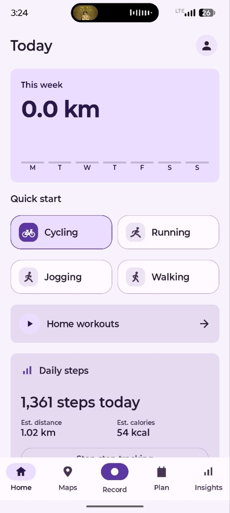
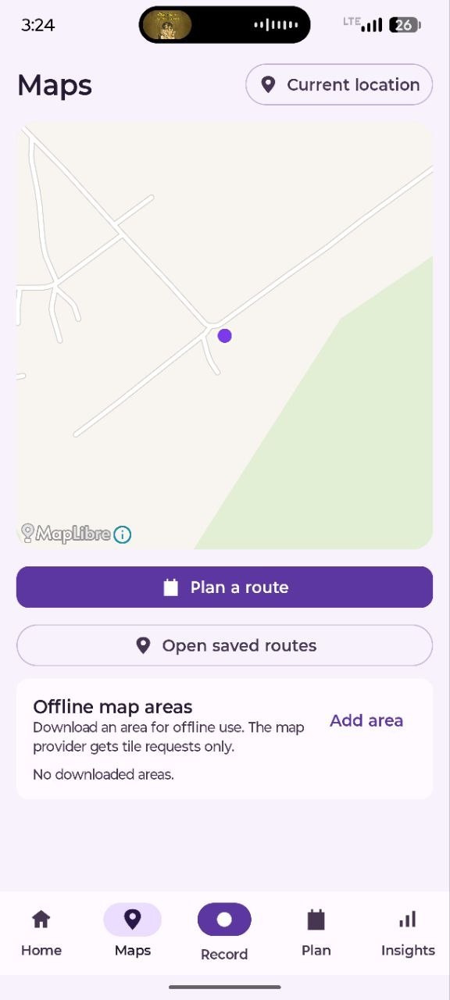
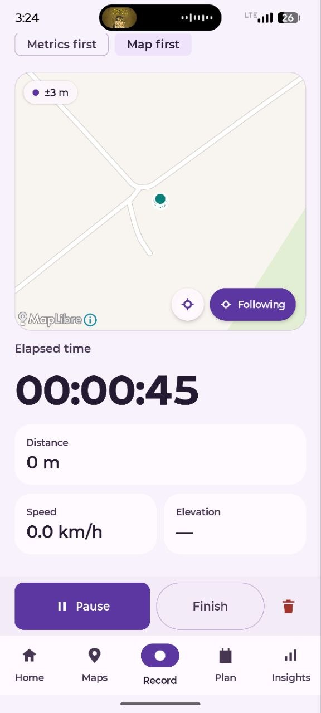
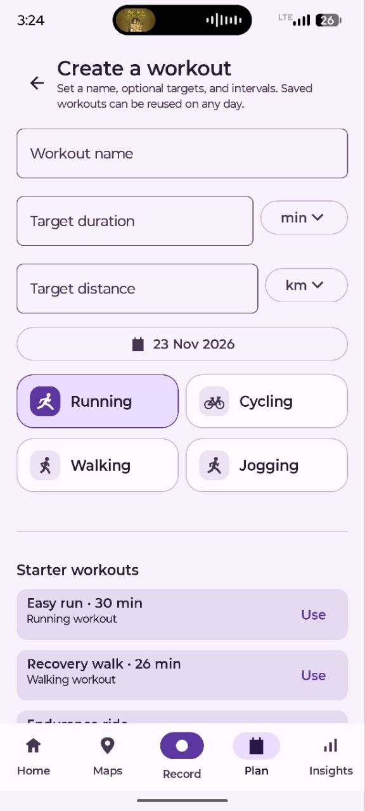
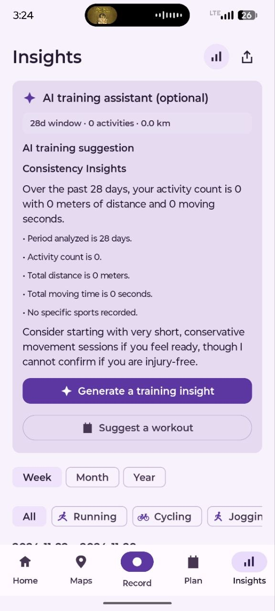

# Pace

## Download

The production release APK is available at [`app/build/outputs/apk/release/app-release.apk`](app/build/outputs/apk/release/app-release.apk). Download the file and install it on an Android device (Android 8.0/API 26 or later). Android may ask you to allow installation from your browser or file manager. This is a locally built release artifact; when this repository is pushed, Git does not host build outputs, so use a GitHub Release asset for public distribution.

## App screenshots

The following five screenshots are included in `app/assets/`:

| Screenshot | Preview | What it shows |
|---|---|---|
| Home |  | Pace's home experience and at-a-glance fitness information. |
| Activity |  | An activity-focused screen in the app. |
| Training |  | A training or workout view. |
| Planning |  | Planning and progress features. |
| Insights |  | Fitness history and insight features. |

The screenshots are presented in supplied order; labels describe the app areas they illustrate at a high level.

Pace is an offline-first Android fitness app for cycling, running, jogging, and walking. The roadmap and build control center are in [Pace · Build Control Center.html](./Pace%20%C2%B7%20Build%20Control%20Center.html).

Pace is implemented in Kotlin + Jetpack Compose. Room remains canonical for
local fitness data; Supabase backup is optional, and AI is opt-in. GPS and
fitness data are private by default.

## Product definition

Phase P00 scope, user journeys, terminology, offline and restore contracts, acceptance criteria, privacy baseline, risks, and phase-gate checklist are documented in [`docs/product/`](docs/product/). The P00 task-to-evidence mapping is in [`docs/product/phase-0-completion.md`](docs/product/phase-0-completion.md). Defaults that need product-owner confirmation are called out in those documents.

## Current status

The app now includes offline GPS recording, history/detail, local analytics, map
and saved-route flows, calendar planning, home-workout circuits, and local
recommendations/forecasts. Offline MapLibre region packs, account-scoped
backup/restore source, privacy controls, optional server-side AI, and release
operations documentation are also implemented. Android compile, unit,
instrumentation-source compile, formatting, and lint checks pass; recording,
history, analytics, planning, map, cloud, and AI runtime acceptance still need
the phone and configured services. Phase 17 has a private Supabase schema,
archive codec, outbox, upload/download transport, explicit opt-in and
account-scoped restore flow. Its six migrations are applied to the configured
Supabase project, the migration history matches, and all 12 Pace tables have
RLS enabled. Both private Storage buckets and all three Edge Functions are
deployed. Mobile cloud acceptance is waiting for a valid project publishable
key: the value most recently supplied is rejected by Supabase as invalid.
Upload defaults off. Profile supports local-data export, confirmed
local data deletion, and backup controls. See phase notes for exact status.
P18 also adds accessibility preferences, privacy disclosures, and help/support.
P19 adds Gradle dependency locks and an OSV vulnerability scan to CI, but its
runtime QA matrix remains open. P20 release identifiers, signing, Play
declarations, and beta enrollment remain owner-controlled. P21 provides an
opt-in server-side AI gateway. OpenRouter and Gemini secrets are configured on
the server, and synthetic provider checks passed; generation remains off by
default until the operator enables the kill switch and each app account opts
in. P22
adds support and recovery procedures, a FAQ, and a changelog; operational
monitoring and cost alerts still require owner-selected services. See
[operations notes](docs/operations/README.md).

## Product UX and visual system

- [Navigation and screen inventory](docs/ux/navigation-and-screen-inventory.md)
- [User flows](docs/ux/user-flows.md)
- [Visual design system](docs/ux/visual-system.md)
- [Annotated screen specifications](docs/ux/screen-specifications.md)
- [Screen concept board](docs/ux/assets/p02-screen-board.svg)
- [P02 completion and acceptance record](docs/ux/phase-2-completion.md)
- [P03 Compose component foundation and gate status](docs/ux/phase-3-component-foundation.md)
- [P04 shell and onboarding implementation record](docs/product/phase-4-completion.md)
- [P05 local model and repository implementation record](docs/product/phase-5-completion.md)
- [P06 account setup and gate status](docs/product/phase-6-completion.md)
- [P10–P11 history and analytics progress](docs/product/phase-10-11-progress.md)
- [P12 dashboard progress](docs/product/phase-12-progress.md)
- [P13 routes and maps progress](docs/product/phase-13-progress.md)
- [P14 planning progress](docs/product/phase-14-progress.md)
- [P15 home workout progress](docs/product/phase-15-progress.md)
- [P16 recommendations and forecasts progress](docs/product/phase-16-progress.md)
- [P17 backup/sync/restore progress](docs/product/phase-17-progress.md)
- [P18 privacy/settings progress](docs/product/phase-18-progress.md)
- [P19 reliability/security progress](docs/product/phase-19-progress.md)
- [P20 beta/release progress](docs/product/phase-20-progress.md)
- [P21 optional AI progress](docs/product/phase-21-progress.md)
- [P22 operations progress](docs/product/phase-22-progress.md)
- [Operations and support](docs/operations/README.md)
- [Supabase development setup](supabase/README.md)

## Toolchain

- Android Studio with Android SDK Platform 36 and Build Tools 36.0.0
- JDK 17
- Gradle 8.13 (via the checked-in wrapper)
- Android Gradle Plugin 8.13.2
- Kotlin 2.2.20 and the matching Compose compiler plugin
- Min SDK 26; target and compile SDK 36

Versions live in `gradle/libs.versions.toml` and `gradle/wrapper/gradle-wrapper.properties`. The application ID `com.pace.app` is provisional; choose a permanent publisher-owned ID before distribution.

## Build and run

On Windows:

```powershell
.\gradlew.bat :app:assembleDebug
.\gradlew.bat :app:lintDebug
.\gradlew.bat :app:testDebugUnitTest
.\gradlew.bat :app:connectedDebugAndroidTest
.\gradlew.bat checkFormatting
.\gradlew.bat :app:installDebug
```

On macOS/Linux:

```sh
./gradlew :app:assembleDebug
./gradlew :app:lintDebug
./gradlew :app:testDebugUnitTest
./gradlew :app:connectedDebugAndroidTest
./gradlew checkFormatting
./gradlew :app:installDebug
```

The app opens in local-only mode without network or Supabase credentials. For device testing, connect an Android phone with USB debugging enabled and run `.\gradlew.bat :app:installDebug` (Windows) or `./gradlew :app:installDebug` (macOS/Linux). An emulator is not required. Instrumented UI tests also run on that connected phone with `:app:connectedDebugAndroidTest`.

GitHub Actions runs the debug build, assembles the instrumented test APK, and runs JVM unit tests, lint, and formatting checks on pushes and pull requests. CI does not start an emulator; run the instrumented UI test on a connected physical phone when one is available.

On a physical phone, enable Daily steps from Home and grant physical activity access. Check that the count advances while GPS recording is active and the screen is off, then add the Pace Steps widget and compare its count with Home. Finish and save an outdoor activity to verify the saved route, the camera stats overlay, and the Android share sheet. Step totals are stored on the device and the tracker does not require a Pace account.

Pace keeps individual daily step totals. Home, the daily activity calendar, and the widget estimate distance at 0.75 m per step and calories at 0.04 kcal per step. These estimates do not add GPS workout totals a second time.

## Release signing

Release APK/AAB builds use a private keystore supplied through environment variables. See [`docs/build-and-signing.md`](docs/build-and-signing.md). With no signing credentials configured, Gradle produces unsigned release artifacts.

## Platform workflow

- [Dependency update procedure](docs/platform/dependency-updates.md)
- [Physical-device test routine](docs/platform/physical-device-testing.md)
- [Android API policy and Android 16 review](docs/platform/android-api-policy.md)
- [Localization baseline](docs/platform/localization.md)
- [Secrets and source control](docs/platform/secrets-and-source-control.md)
- [Play Console readiness](docs/platform/play-console-readiness.md)
- [Core library choices ADR](docs/architecture/0001-core-libraries.md)
- [P01 completion and owner-dependent follow-ups](docs/platform/phase-1-completion.md)
- [Contributing and pull request conventions](CONTRIBUTING.md)

## Repository workflow

1. Read `AGENTS.md` and the relevant roadmap phase/task.
2. Work on one task at a time, including its acceptance criteria.
3. Run the checks for the change and record any unavailable toolchain or device checks.
4. Update the roadmap or decision register only when an approved change warrants it.

Git has been initialized locally. No remote or initial commit is configured.
