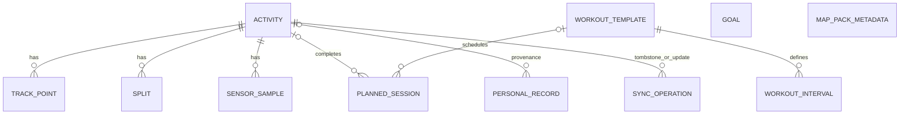

# ADR 0002: Local fitness data, backup, and encryption

- **Status:** Accepted for the P05 local-only foundation
- **Date:** 2026-11-18

## Context

Pace stores private fitness summaries and precise route coordinates. The core
must work without an account or network. Cloud backup and restore are a later,
explicitly invoked product feature; Android device backup must not become an
accidental second copy of the database.

## Decisions

1. Room is the canonical local store for activities, route points, splits,
   optional sensor samples, workout templates and intervals, planned sessions,
   goals, personal records, map-pack metadata, and durable sync operations.
2. The database and settings live in the app's private internal storage. The
   implementation relies on Android app sandboxing and device file-based
   encryption. It does not add SQLCipher or a separate database key in P05.
3. Automatic Android cloud backup and device transfer remain disabled. Legacy
   and current backup/data-extraction rules explicitly exclude databases,
   preferences, app files, and external files. A future P17 backup must be a
   separate, user-invoked, encrypted product flow with restore and deletion
   tests; it must not turn Android Auto Backup on by itself.
4. No routine log or fixture may contain a real route. The test fixture
   generator uses fixed synthetic coordinates only. Sync operation payloads in
   this phase carry summary metadata and tombstones; raw route points remain in
   their dedicated local table.
5. Schema upgrades use explicit Room migrations. Destructive migration
   fallbacks are prohibited. Activity deletion first writes a durable
   tombstone; retention cleanup cannot remove an activity while its delete
   operation is pending or failed.

## Consequences and residual risk

- Local data is protected by Android's per-app storage boundary and device
  encryption, but the database itself is not encrypted with an app-specific
  key. An unlocked or compromised device can access app-readable data. Revisit
  SQLCipher or another at-rest layer if the threat review, launch requirements,
  or device testing show that platform protection is insufficient.
- Disabling automatic backup means uninstall or device loss can remove local
  history until the separately designed P17 export/backup flow exists. The UI
  must not imply that local-only data is recoverable elsewhere.
- Existing P04 preferences migrate once from `pace_local_settings` into
  Preferences DataStore. Room version 1 activity summaries migrate to version
  2 without losing their stored summary fields.

## Local entity relationships

Nullable foreign keys on planned sessions and personal records use `SET NULL`
when the referenced activity/template is physically purged. Track points,
splits, and sensor samples cascade with their activity. Soft deletion remains
the normal user-delete path.

## Versioned choices

- Room: `2.8.5`
- Preferences DataStore: `1.3.0`
- KSP processor plugin compatible with the pinned Kotlin `2.2.20` toolchain:
  `2.2.20-2.0.4`

These versions were checked against the official Google Maven metadata and
Kotlin KSP release information on 2026-11-18.
