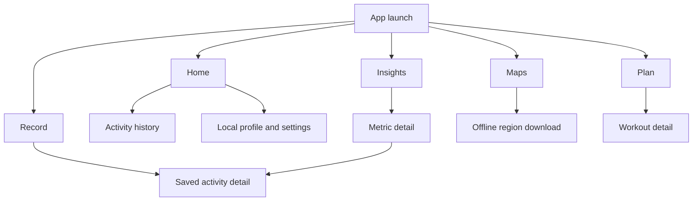

# Navigation and Screen Inventory

**Phase:** P02 UX specification
**Scope source:** P00 product baseline plus the P02 acceptance criteria
**Design owner:** Pace product/design
**Android implementation owner:** Pace Android

## Information architecture

The mobile information architecture has five top-level destinations:

On compact Android screens these destinations use a five-item bottom navigation
bar with a 24 dp icon and a sentence-case label. The active destination uses a
tonal indicator and a full label. On medium and expanded windows the same order
uses a navigation rail or permanent navigation drawer. System Back returns to
the previous screen in the current destination before leaving that destination.

Home is the return point for recent activity, the next useful action, and local
status. Record opens the outdoor activity selection and recording state
machine. Maps opens the map surface and local map status. Plan owns planned
workouts. Insights owns periods, activity filters, charts, and metric details.
History and profile/settings are reached from Home; they do not compete with
the five daily destinations.

## P00 scope reconciliation

P02-T001 names Maps and Plan as top-level destinations. The P00 baseline keeps
offline map downloads conditional on licensing and places the planner in the
provisional V1.1 cut line. This document therefore records the complete
five-destination product IA while retaining those release gates:

- Maps may ship with a limited local fallback in V1. Region discovery and
  downloads require the map licensing and storage review scheduled in P08.
- Plan create/edit/start/complete flows are designed here and may be activated
  only after the P00 MVP cut-line review following P05. Until then, the V1
  navigation configuration omits Plan; it does not show an empty placeholder.
- These UX specifications do not change the V1 cut line or approve a release
  scope change.

## Screen inventory

Each entry has one named role responsible for its UX and acceptance review.

| Screen or modal | Owner | Purpose and primary content |
| --- | --- | --- |
| Welcome / local start | Product/design | Explain local-first use and offer “Continue locally.” |
| Unit preference | Product/design | Select metric or imperial; explain that it can change later. |
| Optional profile | Product/design | Collect only requested details; allow skip. |
| Optional cloud link | Product/design + identity | Explain backup value and data leaving the device; allow defer. |
| Home | Android + product/design | Record action, weekly local summary, recent activity, offline/sync status. |
| Activity history | Android + product/design | Search/filter local saved activities and open detail. |
| Record activity choice | Android + recording | Select cycling, running, jogging, or walking. |
| Location explanation | Android + privacy | Explain why precise location is needed immediately before the permission request. |
| GPS acquiring | Android + recording | Show acquisition state, accuracy, retry, permission/settings guidance, and cancel. |
| Active recording | Android + recording | Show elapsed/moving time, distance, GPS quality, pause, and finish. |
| Paused recording | Android + recording | Preserve session identity, show pause duration, resume or finish. |
| Finish confirmation | Android + recording | Confirm finish when the session has meaningful data; prevent duplicate submissions. |
| Saving / save failure | Android + data | Show finalization, retry, and recovery details without claiming an unsaved session succeeded. |
| Recovered session | Android + recording | Explain interruption and missing-time uncertainty; resume, save, or confirmed discard. |
| Activity detail | Android + analytics | Summary, quality notes, splits, route, metric definitions, edit/delete/export actions. |
| Edit activity metadata | Android + data | Edit permitted metadata while preserving the immutable GPS track. |
| Delete confirmation | Android + privacy | Name the activity and explain the irreversible local deletion. |
| Export activity | Android + privacy | Explain file contents and destination before exporting GPX or summary data. |
| Insights overview | Android + analytics | Period selector, activity filter, summary metrics, chart and empty state. |
| Metric detail | Android + analytics | Definition, calculation, coverage, chart and linked activity/map points. |
| Maps | Android + maps | Show local map coverage, current location state, offline fallback and region status. |
| Region discovery | Android + maps | List licensed downloadable regions, package size, and required free space. |
| Region download progress | Android + maps | Progress, pause/resume, retry, metered-network choice and cancel. |
| Region delete confirmation | Android + maps | Name region and storage amount; explain that downloaded map data will be removed. |
| Plan list | Product/design + planner | List local planned workouts and completed state; V1.1 gate applies. |
| Create/edit workout | Product/design + planner | Choose workout type, duration/intervals, and save/cancel. |
| Workout detail/start | Product/design + planner | Review steps and start a compatible session; record link is explicit. |
| Workout completion | Product/design + planner | Mark completed and show the linked activity when one exists. |
| Local profile/settings | Android + product/design | Units, privacy, permissions help, export, cloud-link status, accessibility preferences. |
| Cloud link / restore | Android + sync | Sign in, list backup timestamp, user-selected restore, partial failure and retry. |
| Confirmation / error dialogs | Owning feature team | Confirm destructive actions; name the problem and the next safe action. |

## Navigation rules

- A selected destination remains selected when a detail screen opens inside it.
- Active recording takes over the full available content area and suppresses
  destination navigation. A persistent system notification is the route back
  to the active session while it runs in the background.
- Leaving an unsaved form prompts only when edits would be lost. Local browsing
  and recording do not wait for network state.
- Profile, units, privacy, and data export are reachable from a visible Home
  action; settings are not hidden behind a gesture.
- Every modal has a clear title, direct primary action, safe cancel action, and
  an accessible focus order.
