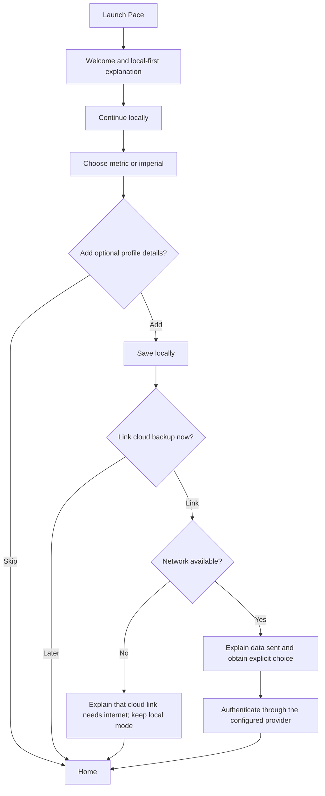
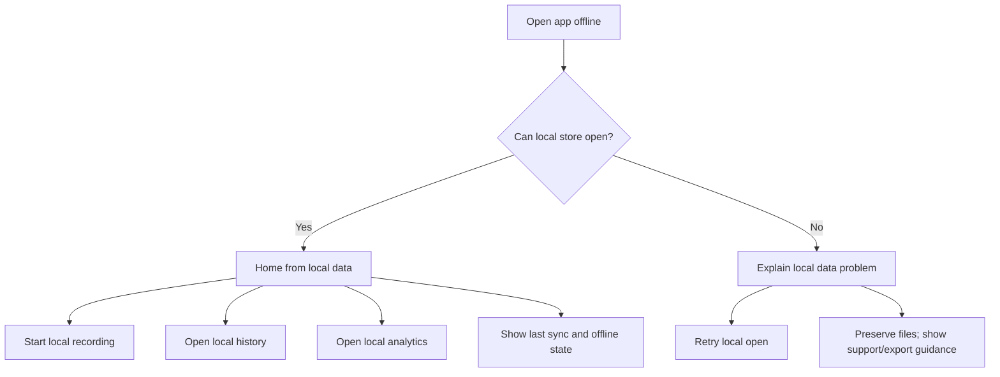
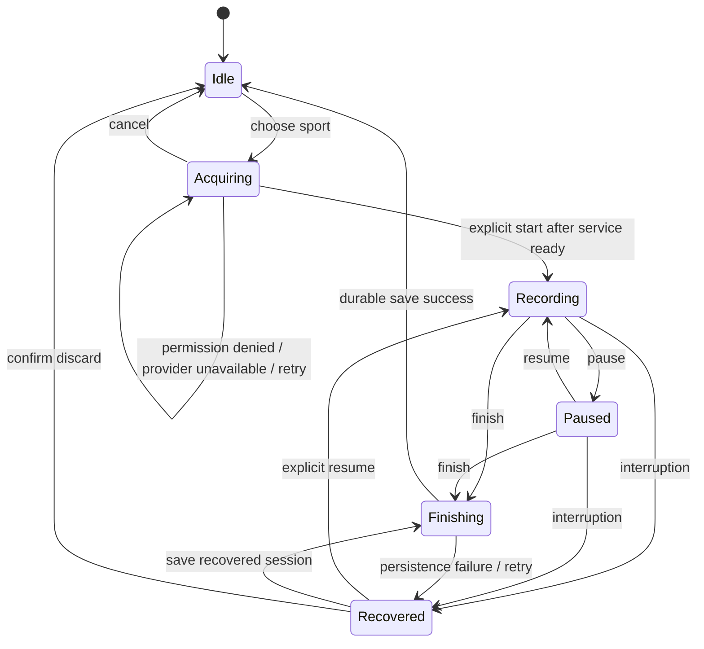
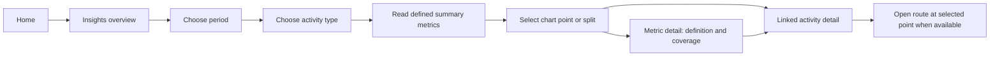
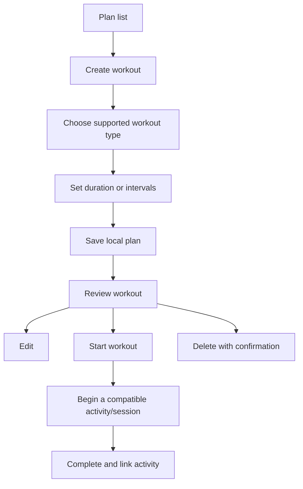
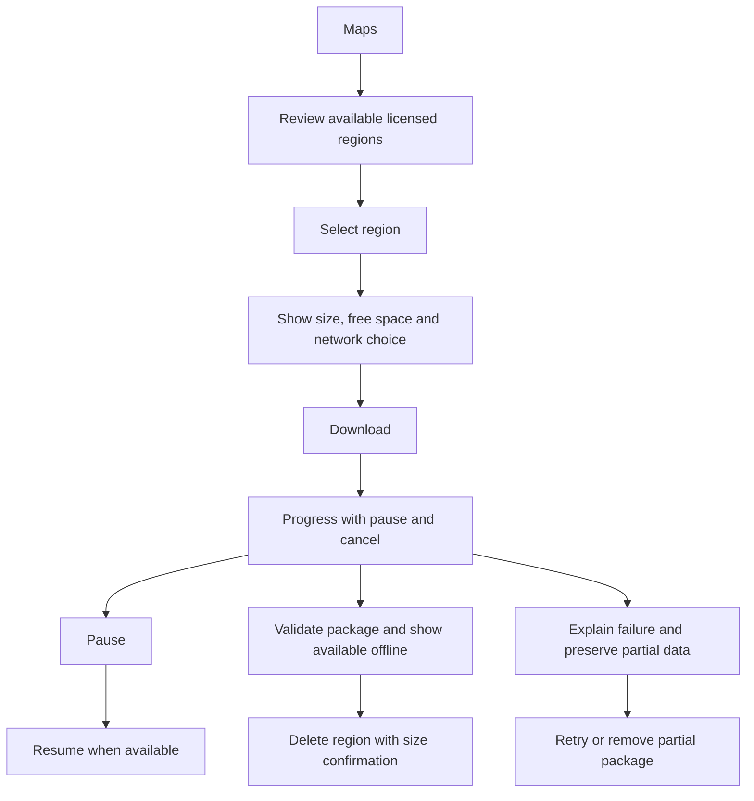

# P02 User-Flow Specifications

These are UX flows, not permission to widen the P00 release scope. Recording,
history, and descriptive analytics stay local. Cloud and region-download paths
are optional services. The Plan flow is specified for P14/V1.1 pending the P00
cut-line review.

## First launch and optional cloud link

Onboarding has one primary action per step. Local mode is the default path.
Optional profile fields can be skipped and edited later. The cloud choice is
separate from the first-run path and never gates use of the recorder. If
authentication fails, preserve local progress and offer retry or “Do this
later.”

## No-internet launch

App launch reads the local profile/database first. It does not wait for network
initialization. A missing connection changes cloud status and any unavailable
map packages; it does not cover the Home screen with a network error. If local
storage fails, provide a specific retry and recovery message and do not create
an empty replacement database silently.

## Create, record, and complete an outdoor activity

| Step | User sees | User action and result |
| --- | --- | --- |
| Choose activity | Cycling, running, jogging, walking | Selection fixes the label for this session. |
| Explain location | Plain-language purpose and permission scope | Continue to the system prompt or cancel. |
| Acquire | GPS/search status, accuracy, retry and settings guidance | Start only when the location service is ready; otherwise retry/cancel. |
| Record | Elapsed time, moving time, distance, GPS quality, pause and finish | Sampling is local; map/network state is not a prerequisite. |
| Pause | Paused label, elapsed time and pause duration | Resume or finish; no distance samples are accepted while paused. |
| Finish | Summary of what will be saved | Confirm; duplicate finish taps cannot create duplicate activities. |
| Save | Finalizing state and then activity detail | On failure, preserve a recoverable session and offer retry. |
| Recover | Interruption timestamp and uncertain interval | Explicitly resume, save, or discard with confirmation. |

All states use the P00 activity state machine and invariants in
[`activity-state-machine.md`](../product/activity-state-machine.md). Elapsed
time includes pauses; moving time excludes explicit pauses only. An activity
with missing samples is labeled incomplete and never shown as a complete route.

## Analytics exploration

The overview identifies the selected period, selected activities, and whether
values come from complete or partial records. A chart selection exposes the
exact date, value, and unit in both visual and spoken form. A linked map opens
only when that activity has route data. Empty history offers a direct “Record
an activity” action. No network is needed.

## Planner flow (P14/V1.1 gated)

Saving a plan is local and works offline. Starting a plan explains whether it
will be linked to a timed session or to an outdoor activity. A planned workout
is distinct from a saved outdoor activity. This flow remains a design artifact
until P00 approves the cut line after P05.

## Offline map-region download flow (licensing gated)

Before starting, the UI names the selected region, download size, required free
space, current connection type, and whether the package is licensed for use.
Interrupted downloads offer resume. Integrity failures keep the old usable
package and give a retry action. A delete action names the package and storage
amount before removal. P08 must approve licensing and storage behavior before
this flow is exposed to users.
